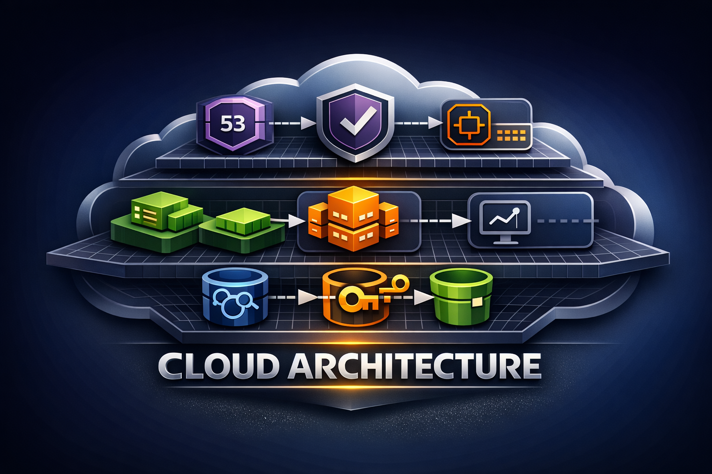

### AWS Virtual Private Cloud (VPC) Configuration

```

This Terraform configuration creates a Virtual Private Cloud (VPC) in Amazon Web Services (AWS) with the following components:

- A VPC with a specific CIDR block of 10.0.0.0/16 and tagged with "main-vpc".
- 6 subnets, 3 public and 3 private, with CIDR blocks generated based on the count.index.
- An Internet Gateway with the tag "main-igw" and associated with the VPC.
- 2 route tables, public and private, with respective tags "public-route-table" and "private-route-table".
- Public route table associated with public subnets and private route table associated with private subnets.
- A default route to the internet through the main Internet Gateway.

```
    ### AWS Provider Configuration
```

The provider block sets up the AWS provider for Terraform and allows for the region to be set using the var.region variable. The access 
and secret keys are also specified. This setup makes it possible to use a different region by simply changing the value of var.region.

```
### Subnet Configuration

```
The subnets are created in the aws_subnet block with the public subnets tagged with "public-${count.index + 1}" and private subnets tagged with "private-${count.index + 1}". The CIDR blocks for these subnets are generated based on the value of count.index.

```

### Internet Gateway Configuration

```
An Internet Gateway is created in the aws_internet_gateway block and tagged with "main-igw". It is associated with the main VPC.

```

### Route Table Configuration

```

The public and private route tables are created in the aws_route_table block, with respective tags "public-route-table" and 
"private-route-table".

```
### Route Table Association Configuration

```

The public route table is associated with the public subnets in the aws_route_table_association block, and the private route table is associated with the private subnets.

```
### Default Route Configuration

```

A default route to the internet is created in the aws_route block, where the destination CIDR block is set to 0.0.0.0/0 and the gateway is the main Internet Gateway.

```

### AWS Infrastructure Configuration for S3 and RDS 

```
This Terraform script creates an S3 bucket, applies server-side encryption and lifecycle policies to it, and sets up a policy to deny public access to the bucket. It also provisions an RDS instance with a PostgreSQL engine, along with an IAM policy to enable access to the S3 bucket for the RDS instance.

-  Generates a random name for the S3 bucket using random_pet resource
-  Creates an S3 bucket with a randomly generated name, applies server-side encryption, and sets up a lifecycle policy to transition  objects to Standard-IA after 30 days
-  Applies a policy to deny public access to the S3 bucket
-  Creates an IAM policy to enable the RDS instance to access the S3 bucket and its objects
-  Creates an RDS instance with a PostgreSQL engine and provisions it with a parameter group, subnet group, security group, and sets up an endpoint output

```

### Provisioning AWS Route 53 DNS Record for EC2 Instance 

```

- The variable block defines a variable named domain_name with the type string. This allows the user to input the domain name they want to use.
- The output block defines an output named public_ip with the value of the first public_ip attribute of the EC2 instance resource. This allows the user to retrieve the public IP address of the instance after it's created.
- The data block uses the aws_route53_zone data source to retrieve the Route53 hosted zone ID for the given domain name.
- The resource block creates a new Route53 aws_route53_record resource. This resource maps the domain name to the EC2 instance's public IP address by creating a DNS record of type A. The zone_id argument specifies the ID of the Route53 hosted zone, which is obtained from the data block. 
- The ttl argument specifies the time-to-live value for the DNS record, and the records argument specifies the IP address to which the domain name should resolve. In this case, the IP address is taken from the public_ip output of the EC2 instance resource.


```

### Provisioning AWS Security Groups for Application and Database Instances with Terraform


# aws-infra ☁️

<p align="center">
    
</p>

This repository provisions an AWS environment for a web application using Terraform. The current implementation in `ec2.tf` builds a VPC, public and private subnets, an Application Load Balancer, an Auto Scaling Group backed by a launch template, an encrypted PostgreSQL RDS instance, an encrypted S3 bucket, IAM roles and policies for EC2, Route 53 DNS, ACM-backed HTTPS, KMS keys, and CloudWatch alarms/logging.

## What `ec2.tf` provisions 🏗️

### Networking 🌐

- A VPC with CIDR block `10.0.0.0/16`
- Public and private subnets across all available availability zones in the selected region
- An internet gateway
- Separate public and private route tables
- Public route table associations for public subnets
- Private route table associations for private subnets

### Compute and scaling 🖥️

- An EC2 launch template using:
    - AMI from `var.ami`
    - Instance type `t2.micro`
    - Key pair `SG`
    - Public subnet placement
    - Public IP association
    - 50 GB encrypted gp2 root volume
    - IAM instance profile attachment
    - User data that updates application config to use the provisioned RDS endpoint and S3 bucket
- An Auto Scaling Group with:
    - Minimum size `1`
    - Maximum size `3`
    - Launch template version `$Latest`
    - Registration with the load balancer target group

### Load balancing and DNS 🔀

- An internet-facing Application Load Balancer
- An HTTPS listener on port `443`
- A target group forwarding traffic to application instances on port `5000`
- A Route 53 alias `A` record pointing the domain to the load balancer
- ACM certificate lookup for the configured domain

### Security groups 🔐

- Load balancer security group:
    - Allows inbound `80` and `443` from anywhere
    - Allows all outbound traffic
- Application security group:
    - Allows inbound `5000` only from the load balancer security group
    - Allows all outbound traffic
- Database security group:
    - Allows inbound `5432` only from the application security group

Note: SSH ingress is currently commented out in the Terraform.

### Storage, database, and encryption 🗄️

- An S3 bucket with a generated unique name
- S3 server-side encryption enabled with `AES256`
- S3 lifecycle transition to `STANDARD_IA` after 30 days
- S3 public access block configuration
- Bucket policy that denies insecure transport
- A PostgreSQL RDS instance:
    - Engine `postgres`
    - Version `13.3`
    - Instance class `db.t3.micro`
    - Private subnet group placement
    - Storage encryption enabled with a customer-managed KMS key
- Customer-managed KMS keys and aliases for:
    - RDS encryption
    - EBS encryption

### IAM and observability 📊

- An EC2 IAM role and instance profile
- IAM policy granting the application access to S3 and CloudWatch APIs
- Attachment of `CloudWatchAgentServerPolicy`
- A CloudWatch log group
- CloudWatch alarms and autoscaling policies for scale up and scale down based on EC2 CPU utilization

## Input variables 🧾

`ec2.tf` expects these input variables:

- `region`: AWS region to deploy into
- `ami`: AMI ID used by the EC2 launch template
- `domain_name`: Hosted zone domain used for ACM lookup and Route 53 record creation

## Outputs 📤

The Terraform configuration exposes these outputs:

- `bucket_name`
- `rds_endpoint`
- `load_balancer_dns_name`

## How to run 🚀

```bash
terraform init
terraform plan
terraform apply
```

Terraform will prompt for required variables unless you provide them through a `.tfvars` file, environment variables, or CLI flags.

Example:

```bash
terraform apply \
    -var="region=us-east-1" \
    -var="ami=ami-xxxxxxxxxxxxxxxxx" \
    -var="domain_name=example.com"
```

## Prerequisites and assumptions ✅

- The AWS CLI profile `demo` must exist locally because the provider is configured with `profile = "demo"`.
- The EC2 key pair `SG` must already exist in the target AWS account and region.
- A matching ACM certificate for `domain_name` must already be issued in AWS.
- A Route 53 hosted zone for `domain_name` must already exist.
- The AMI supplied through `var.ami` must contain the expected application files under `/home/ec2-user/scripts/webApp/` because the user data script modifies files in that path.

## Important implementation notes ⚠️

- The load balancer currently references the first three public subnets explicitly, so the selected region must expose at least three availability zones.
- The application is expected to serve traffic on port `5000` and expose a `/healthz` endpoint for target group health checks.
- Database credentials are currently hardcoded in Terraform and should be moved to a more secure mechanism such as AWS Secrets Manager or SSM Parameter Store.